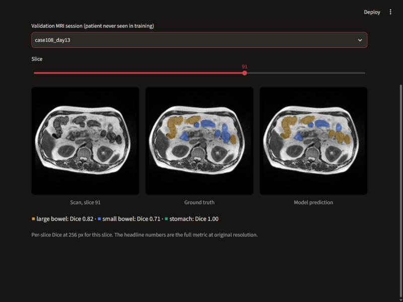
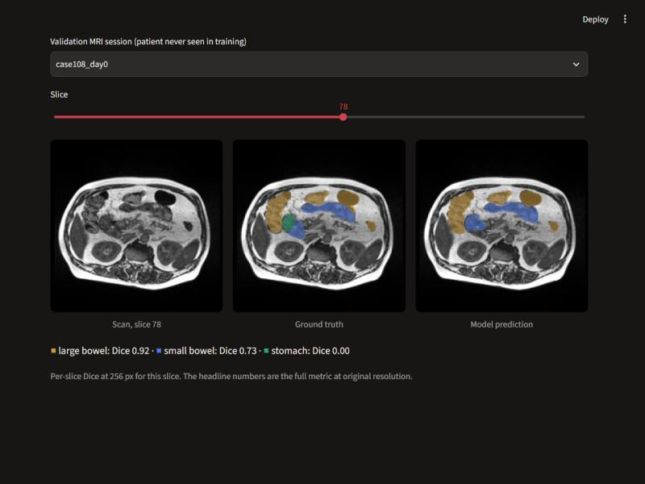
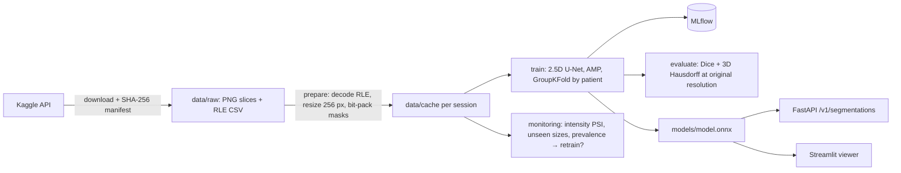

# GI tract MRI segmentation: 2.5D U-Net, end to end

Automatic outlining of the **stomach, small bowel and large bowel** on abdominal MRI (the
[UW-Madison GI Tract Image Segmentation](https://www.kaggle.com/competitions/uw-madison-gi-tract-image-segmentation)
dataset: 274 MRI sessions from 85 patients, 38,496 slices). In MR-guided radiotherapy these organs are
outlined by hand on every session so the beam can avoid them; this project automates that step and
ships it as a production-style system:

- **Data pipeline:** run-length-encoded masks decoded and verified, every session cached as compact
  `uint8` images plus bit-packed masks
- **2.5D input:** slices *z − 2, z, z + 2* stacked as channels, giving a 2D network depth context almost
  for free
- **U-Net with a ResNet-34 encoder**, mixed-precision training on a 6 GB laptop GPU, tracked in **MLflow**
- **The competition metric re-implemented:** 0.4 × Dice + 0.6 × (1 − normalised 3D Hausdorff), unit-tested
- **ONNX** export, a **FastAPI** segmentation service that needs no PyTorch, a **Streamlit** viewer,
  **Docker**, **CI** and **drift monitoring**

> **Research demonstration only.** Not a medical device, not clinically validated, not for diagnosis or
> treatment planning. See the [model card](MODEL_CARD.md).

## Results

Validation on 55 MRI sessions from patients the model never saw in training (one fold of a 5-fold
GroupKFold by patient), scored at each session's original resolution (higher is better):

| Model | Score | Dice | Hausdorff (normalised, lower is better) |
|---|---:|---:|---:|
| **2.5D U-Net, ResNet-34 encoder** | **0.9340** | 0.9108 | 0.0506 |
| Predict nothing (baseline) | 0.2802 | 0.7005 | 1.0000 |

| Organ | Score | Dice | Hausdorff |
|---|---:|---:|---:|
| stomach | 0.9664 | 0.9584 | 0.0283 |
| large bowel | 0.9272 | 0.9041 | 0.0574 |
| small bowel | 0.9083 | 0.8700 | 0.0661 |

**Why the baseline gets 0.70 Dice:** most slices contain no organ, and an empty prediction on an empty
slice counts as perfect. The 3D Hausdorff term is what separates a real model from that.

**How this compares with Kaggle:** these numbers come from one validation fold, not from the
competition's hidden test set, so they are **not comparable with the leaderboard**. It is a code
competition: a hidden-test score can only come from a submission run inside a Kaggle notebook, which this
repository does not include yet.

Training: 15 epochs, batch 16, one-cycle learning rate (peak 0.001), mixed precision, 131 minutes on an
RTX 3050 Laptop GPU (6 GB). Full tables with the MLflow run ids are in [RESULTS.md](RESULTS.md), generated
by `python -m gisseg.report`.

## Screenshots

The viewer compares the ground truth with the model on validation patients.

| A typical slice | An honest miss |
|---|---|
|  |  |

**The miss:** on `case108_day0`, slice 78, a small piece of stomach (green, centre) is not predicted at all,
so the stomach Dice for that slice is 0.00, while the bowel is outlined well. Small, low-contrast organ
fragments at the edge of an organ's extent are where this model fails most often.

## Architecture



## Quick start

Needs Python 3.12 and [uv](https://docs.astral.sh/uv/). The Kaggle data needs an API token, and the
competition rules must be accepted on kaggle.com.

```bash
uv sync --extra train --extra dashboard        # CUDA PyTorch on Windows, CPU PyTorch on Linux
uv run python scripts/download_data.py         # Kaggle API -> data/raw (~2.4 GB) + data/MANIFEST.json
uv run python -m gisseg.data.prepare           # -> data/cache (per-session arrays)
uv run python -m gisseg.train                  # train, evaluate, export ONNX, log to MLflow
uv run python -m gisseg.report                 # RESULTS.md from MLflow
uv run python -m gisseg.monitoring             # drift report + retrain flag
uv run uvicorn gisseg.serve.api:app --port 8020   # http://localhost:8020/docs
uv run streamlit run app/viewer.py             # viewer
```

Quick smoke run: `uv run python -m gisseg.train --epochs 1 --limit 4`.

Docker (API + viewer; the model, reports and cache are mounted read-only): `docker compose up --build`.
The image installs only ONNX Runtime, not PyTorch.

> **Windows with a small paging file:** DataLoader workers and pinned memory can exceed the commit limit
> (error 1455). The config uses `num_workers: 0` and pinned memory is off; raise workers on Linux.

## API

Base URL `http://localhost:8020`. Interactive docs are at `/docs`; the schema is in [openapi.json](openapi.json).

| Method | Path | Returns |
|---|---|---|
| GET | `/health` | `{"status": "ok"}` |
| GET | `/v1/model` | model details and validation scores |
| POST | `/v1/segmentations` | a run-length-encoded mask, area and presence flag for each organ |

`POST /v1/segmentations` takes multipart form data:
- `slices`: 1 grayscale PNG, or 3 consecutive slices (*z − 2, z, z + 2*);
- `volume_p995` (optional, **strongly recommended**): the 99.5th-percentile intensity of the whole MRI
  session.

**Why `volume_p995` matters:** the model was trained on slices normalised by their whole session's
intensity. Without that value, the API can only normalise by the slices it receives, which shifts the
contrast. On one validation slice (`case108_day0`, slice 73), stomach Dice was **0.245 without it and
0.604 with it**. The response field `normalisation` says which was used (`volume` or `slices`).

Every error uses the same shape, `{"error": {"code", "message", "details"}}`. The codes are
`invalid_slice_count`, `invalid_image`, `size_mismatch`, `file_too_large` (413), `validation_error` and
`not_found`.

## Monitoring

`python -m gisseg.monitoring` compares new sessions with the training reference. On the 55 validation
sessions: intensity PSI 0.069, unseen image sizes 0%, organ-prevalence change 0.015, so all three checks
pass and **no retrain is recommended**. The thresholds are in the [model card](MODEL_CARD.md#monitoring).

## Project layout

```
configs/default.yaml        paths, image size, 2.5D stride, folds, model and training settings
scripts/download_data.py    Kaggle download + manifest
src/gisseg/
  rle.py                    run-length encode / decode (competition format)
  volume.py                 bit-packing, 2.5D stacking (NumPy only, shared by training and serving)
  metrics.py                Dice and normalised 3D Hausdorff
  data/prepare.py           raw PNG + CSV -> per-session cache
  data/dataset.py           2.5D dataset with augmentation
  train.py                  training, evaluation, ONNX export, MLflow
  report.py                 RESULTS.md from MLflow
  monitoring.py             drift checks -> retrain flag
  serve/api.py              FastAPI service on ONNX Runtime
app/viewer.py               Streamlit viewer
tests/                      synthetic MRI-like data: RLE, metric, data, training, API contract tests
```

## Data and licence

The competition data is **not** in this repository. It may only be used for non-commercial and academic
purposes under the competition rules, so download it with your own Kaggle account. The code is
MIT-licensed.
